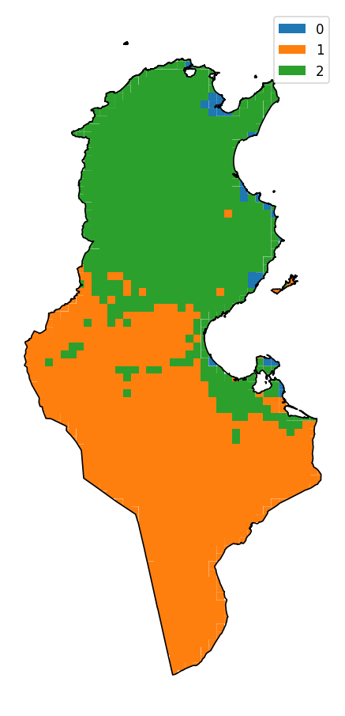
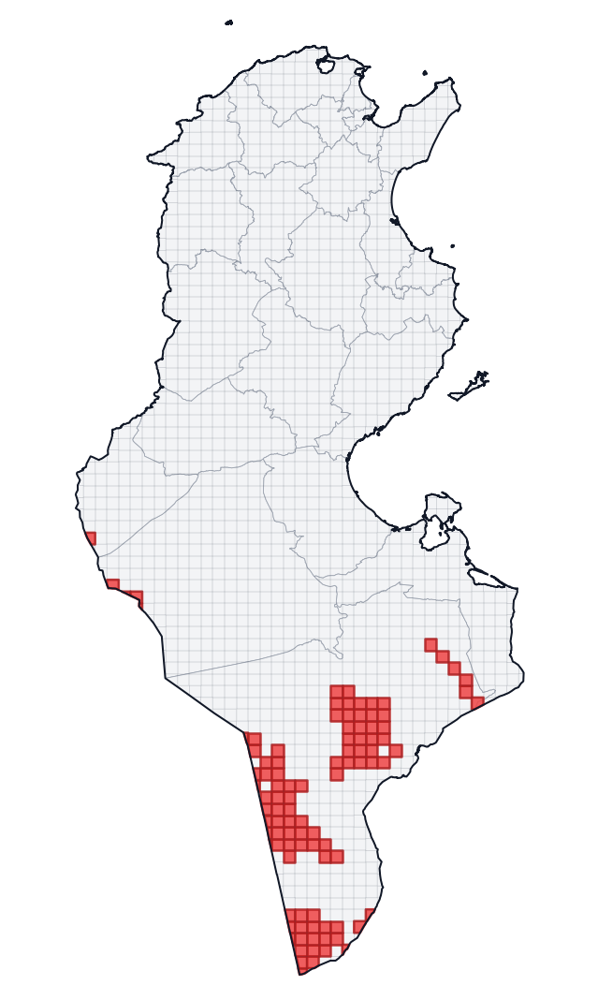
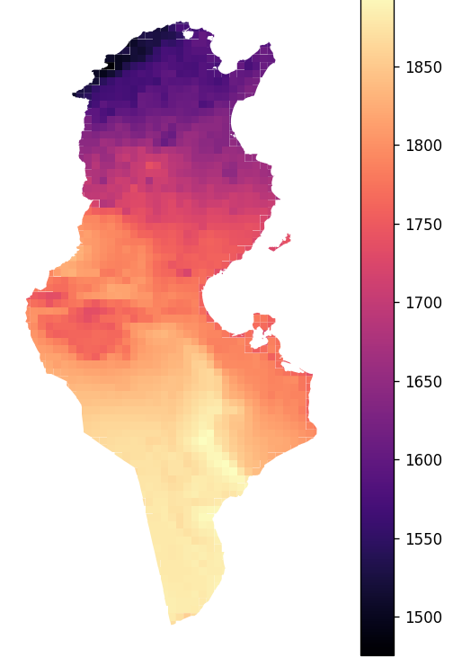
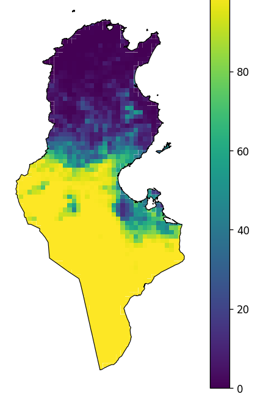
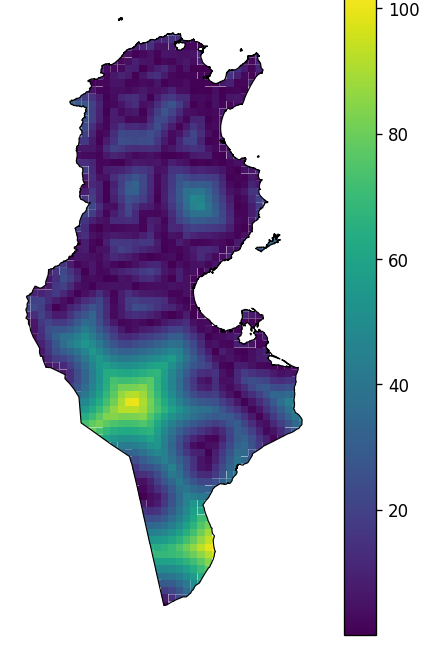

# Tunisia Solar Priority Zones

Screening the whole of Tunisia for zones where solar photovoltaic development is worth studying first, using open geospatial data and unsupervised machine learning.

**Authors:** Seifeddine Abroud and Ghezlen Ben Abdrahmen  
**Programme:** 2nd year Professional Master's in Data Science, Institut Supérieur d'Informatique de Mahdia  
**Supervisor:** Mme Sirine Marrakchi

  
  

<i>Left: the three territories found by K-Means. Right: the 100 shortlisted cells.</i>

## The question

Tunisia targets 35% renewable electricity by 2030, and the sun is not the limiting factor. The difficulty is that the sunniest land is far from roads and power lines, while the well-connected land is farmed or built on. No public map combines these dimensions.

This project builds one. It is a **screening exercise that narrows the search, not a decision to build**.

## What we did

1. **Cut** Tunisia into 1,659 cells of 10 km.
2. **Collect** open data on sun, people, land cover and infrastructure.
3. **Describe** every cell with seven features.
4. **Group** similar cells with six clustering models and compare them.
5. **Rank** the eligible cells into a shortlist that does not depend on hand-picked weights.

### Features

| Feature | Source |
|---|---|
| Solar output (PVOUT) | Global Solar Atlas |
| Population density | WorldPop 2020 |
| Built-up, cropland and bare-land shares | ESA WorldCover 2021 |
| Distance to a main road, distance to a power line | OpenStreetMap |

Only one solar variable is used, because GHI, DNI and PVOUT are almost perfectly correlated. Population and distances are log-transformed, and all features are standardised.

## Results

### Six models compared

| Model | Clusters | Noise % | Silhouette | Davies-Bouldin | Calinski-Harabasz | Agreement with K-Means (ARI) |
|---|---|---|---|---|---|---|
| **K-Means** | 3 | 0.0 | **0.451** | 0.813 | **1147.5** | 1.000 |
| Agglomerative (Ward) | 3 | 0.0 | 0.415 | 0.808 | 1016.2 | 0.665 |
| Gaussian Mixture | 3 | 0.0 | 0.248 | 1.619 | 694.9 | 0.359 |
| Birch | 3 | 0.0 | 0.398 | 0.856 | 819.0 | 0.450 |
| Spectral | 3 | 0.0 | 0.241 | 1.035 | 892.7 | 0.620 |
| HDBSCAN | 3 | 54.7 | 0.520 | 0.543 | 250.8 | 0.542 |

K-Means with three clusters was kept. It is the best separated model among those that classify every cell, and five different random seeds give exactly the same partition. HDBSCAN scores higher only because it leaves 54.7% of the cells unclassified.

The models agree only partly (ARI between 0.36 and 0.67): they share the broad north-south picture but draw the borders differently.

### Three territories

| Cluster | Cells | Solar output (kWh/kWp per year) | Bare land | Typical distance to a power line |
|---|---|---|---|---|
| Desert south | 880 | 1,833 | 95% | 23 km |
| Farmland north and centre | 750 | 1,676 | 17% | 6 km |
| Urban areas | 29 | 1,659 | 8% | 3 km |

### Shortlist

Built-up, water and urban cells are set aside, leaving 1,618 eligible cells. They are ranked on solar output, bare land, distance to a power line and population, **1,000 times with random weights**. The 100 most robust cells are almost all in Tataouine (95), with a few in Kébili (4) and Tozeur (1). The best cell reaches the top 100 in 96% of the runs.

  
  
  

<i>Solar output, bare-land share and distance to the nearest power line.</i>

## Limits

- Terrain slope, land ownership and protected areas are not included.
- Distance to a power line says nothing about the capacity of that line.
- OpenStreetMap may be incomplete, especially in the south.
- Solar output and bare-land share are correlated (0.87), so the desert signal is partly counted twice.

## Repository contents

| Path | What it is |
|---|---|
| `notebooks/tunisia_solar_priority_zones.ipynb` | The full pipeline, from raw data to shortlist (Google Colab) |
| `notebooks/kaggle_six_models.ipynb` | A short notebook that starts from the prepared table and compares the six models |
| `data/` | The prepared tables (see `data/README.md`) |
| `figures/` | Maps and charts from our run |
| `report/Tunisia_Solar_Report.pdf` | The written report |

## How to run

**Quick version (a few seconds, no accounts needed).** Run `notebooks/kaggle_six_models.ipynb` with `data/features_clean.csv` next to it. It needs only pandas, scikit-learn and matplotlib.

**Full pipeline (Google Colab, CPU runtime).**

1. Open `notebooks/tunisia_solar_priority_zones.ipynb` in Colab with the badge above.
2. Download the Tunisia GeoTIFF package from the [Global Solar Atlas](https://globalsolaratlas.info/download/tunisia) and put the files in `MyDrive/tunisia_solar/raw/solar/`.
3. Set `EE_PROJECT` in Section 4 to your own Google Earth Engine project.
4. Choose Runtime > Restart session and run all.

Everything else (boundaries, population, OpenStreetMap extract) is downloaded by the notebook.

## Data credits

- Global Solar Atlas 2.0, World Bank Group, ESMAP and Solargis, CC BY 4.0
- WorldPop, University of Southampton
- ESA WorldCover 10 m 2021 v200, Zanaga et al. 2022, doi:10.5281/zenodo.7254221
- © OpenStreetMap contributors, ODbL, extract from Geofabrik
- geoBoundaries, Runfola et al. 2020

## Licence

Code is released under the MIT licence (see `LICENSE`). The data keep the licences of their sources listed above.
